  

  

  
  
  
  

---

## 👋 Hi, I'm Ameni

I'm a **QA Automation Engineer** who builds test suites that catch the bug before your users do — from the browser, down through the API, all the way into the pipeline.

- 🔭 Currently automating **UI + API tests** for life-insurance platforms (KELIA / KARMA) at **RGI Group** with Playwright, TypeScript and Cucumber
- 🤖 Using **AI coding agents** (Claude Code, GitHub Copilot) and **MCP** in my daily QA workflow — always with human review
- 🧪 Background: Selenium / Java frameworks for **Smart Metering** at Sagemcom, 1,000+ sanity test cases
- 🎓 **ISTQB® CTFL v4.0** · **A4Q Certified Selenium Tester** · Telecommunications Engineer
- 🌍 Based in **Tunisia** · I work in Arabic, French and English
- 💬 Ask me about **test strategy, BDD, Playwright, flaky tests, CI/CD**

## 🧰 Tech stack

**Test automation**

  
  
  
  
  
  
  
  
  
  

**AI-assisted QA**

  
  
  
  

**Languages & tools**

  

## 🚀 Featured projects

| Project | What it shows |
|---|---|
| 🎭 [**playwright-bdd-ai-e2e**](https://github.com/AmeniMhamdi/playwright-bdd-ai-e2e) | Playwright + TypeScript + Cucumber BDD · 4 browsers + API tests · CI/CD with live report · AI-agent workflow (Claude Code + Playwright MCP) |
| ☕ [**selenium-java-cucumber-bdd**](https://github.com/AmeniMhamdi/selenium-java-cucumber-bdd) | Selenium 4 + Java 17 + Cucumber + JUnit 5 · Page Objects + DI · Chrome / Firefox CI matrix |
| 🔌 [**Playwright-mcp-server**](https://github.com/AmeniMhamdi/Playwright-mcp-server) | Playwright driven through the Model Context Protocol |
| 🧱 [**End-to-End-3-Layer-Testing**](https://github.com/AmeniMhamdi/End-to-End-3-Layer-Testing) | End-to-end testing across UI, API and data layers |
| 🌐 [**Portfolio**](https://amenimhamdi.github.io/Portfolio/) | My personal website |

## 🏅 Certifications

  
  
  
  

## 📊 GitHub stats

  
  

  

  

